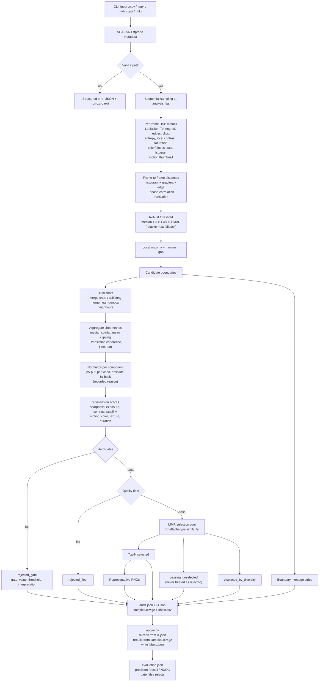

# Pipeline flowchart

## Stage notes

| Stage | Deterministic? | Evidence saved |
|---|---|---|
| Metadata + hash | yes | source block, SHA-256, container, codec, rotation |
| Sampling | yes | sample count, analysis resolution |
| Per-frame metrics | yes | shot-level aggregates, frame distances |
| Boundary detection | yes | median, dispersion, source, threshold, peaks |
| Shot merge | yes | boundary positions, merge similarity, shots before/after |
| Aggregation | yes | raw shot metrics, aggregation strategy, stability source |
| Normalization | yes | per component: raw variable, unit, transform, bounds, source, fallback reason |
| Scoring | yes | 8 dimension scores, component scores, effective weights |
| Gating | yes | failed gate, value, threshold, interpretation |
| Quality floor | yes | enabled flag, minimum score, resulting status |
| MMR selection | yes | rank, objective, similarity to already selected, displaced shots |
| Export | yes (except timestamp) | JSON, CSV, PNG and montage paths |
| Client re-rank | yes | config export reproduces the CLI ranking |
| Evaluation | yes | metrics, gate diagnostics, dimension separation, pairwise accuracy |
